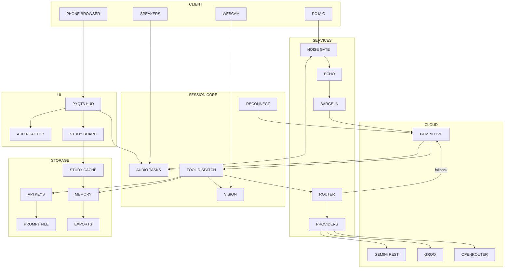
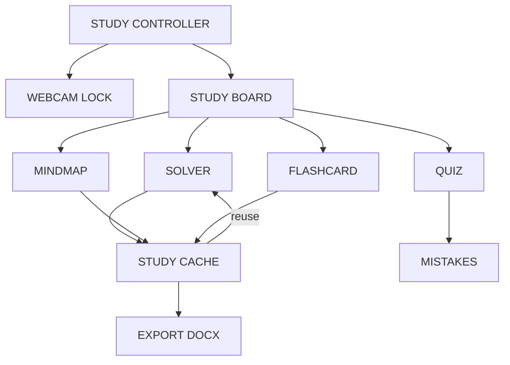

# 📐 draw.io Architecture Pack — JARVIS MARK LX

For **draw.io / diagrams.net** (web or desktop). Three ways in, in order of reliability:

| Route | How | Result |
|---|---|---|
| 🥇 **Mermaid paste** | `+` (Insert) → **Advanced** → **Mermaid…** → paste → Insert | Correct labels + boxes, auto layout |
| 🥈 **AI prompt** | Paste the prompt in section 3 into draw.io AI (or any chat AI) | Rough diagram; fix by hand |
| 🥉 **XML paste** | `Extras` → **Edit Diagram…** → paste XML → OK | Full control, exact coordinates |

Recommended: **Mermaid** for structure, then apply the style presets (section 4).

---

## 1. ⚙️ Configure draw.io first (2 minutes, one time)

| Setting | Where | Value |
|---|---|---|
| Page size | `File` → `Page Setup` → Landscape → A3 | A3 fits the 6 lanes |
| Grid | `View` → `Grid` (tick it) | default 10 pt |
| Snap | `View` → `Snap to Grid` | on |
| Guides | `View` → `Guides` | on |
| Theme | `Extras` → `Theme` → **Kennedy** | light neutral, best for print |
| Font | select all → `Text` → Font → **Inter** (or Helvetica) | 12 px body |
| Arrow style | `Format` → `Edit Style` on a connector | `edgeStyle=orthogonalEdgeStyle;` (right angles) |
| Export | `File` → `Export as` → PNG | Zoom 200%, Background on |

**Why Kennedy theme:** the default dark theme makes exported diagrams look sci-fi.
You asked for real-life engineering look — light background, thin gray lines.

---

## 2. 🧩 Mermaid — main architecture (paste this)

`+` → `Advanced` → `Mermaid…` → paste → **Insert**.



**Result:** 6 lanes, 22 boxes, ~26 arrows. Then drag lanes to order
CLIENT → UI → SESSION CORE → SERVICES → CLOUD → STORAGE and use
`Arrange` → `Layout` → **Vertical Tree** if the layout is scruffy.

---

## 3. 🤖 AI prompt for draw.io AI (or any chat AI)

If your draw.io build has an AI box, paste this. If not, paste it into ChatGPT /
Gemini / Claude and ask for **Mermaid**, then use section 2's import path.

```text
Create a Mermaid "flowchart TD" only — no explanation, no prose, no XML.

It must contain exactly 6 subgraphs used as horizontal swimlanes, in this order,
each titled in capitals: CLIENT, UI, SESSION CORE, SERVICES, CLOUD, STORAGE.

Boxes per subgraph, exactly these names, 1 to 3 words each:
CLIENT: PC MIC, WEBCAM, SPEAKERS, PHONE BROWSER
UI: PYQT6 HUD, ARC REACTOR, STUDY BOARD
SESSION CORE: AUDIO TASKS, TOOL DISPATCH, VISION, RECONNECT
SERVICES: NOISE GATE, ECHO, BARGE-IN, ROUTER, PROVIDERS
CLOUD: GEMINI LIVE, GEMINI REST, GROQ, OPENROUTER
STORAGE: API KEYS, PROMPT FILE, MEMORY, STUDY CACHE, EXPORTS

Edges, exactly these directions:
PC MIC -> NOISE GATE
WEBCAM -> VISION
PHONE BROWSER -> PYQT6 HUD
PYQT6 HUD -> AUDIO TASKS
AUDIO TASKS -> NOISE GATE
NOISE GATE -> ECHO
ECHO -> BARGE-IN
BARGE-IN -> GEMINI LIVE
GEMINI LIVE -> AUDIO TASKS
GEMINI LIVE -> TOOL DISPATCH
TOOL DISPATCH -> ROUTER
ROUTER -> PROVIDERS
PROVIDERS -> GROQ
PROVIDERS -> GEMINI REST
PROVIDERS -> OPENROUTER
ROUTER -> GEMINI LIVE with edge label "fallback"
TOOL DISPATCH -> VISION
TOOL DISPATCH -> MEMORY
TOOL DISPATCH -> API KEYS
RECONNECT -> GEMINI LIVE
PYQT6 HUD -> ARC REACTOR
PYQT6 HUD -> STUDY BOARD
STUDY BOARD -> STUDY CACHE
STUDY CACHE -> MEMORY
MEMORY -> EXPORTS

Rules: no parentheses, no punctuation inside labels, no emojis, no stylization,
no classDef, no linkStyle, plain default Mermaid so it imports cleanly.
```

Save the answer as **`.mmd`** or paste straight into the Mermaid import box.

---

## 4. 🎨 Style presets (the "configuration" for the look)

Select a shape → press `Ctrl+Shift+E` / right-click → `Edit Style` → paste one line.

**Box (normal):**
```text
rounded=1;whiteSpace=wrap;html=1;fillColor=#FFFFFF;strokeColor=#333333;strokeWidth=1;fontFamily=Inter;fontSize=12;fontColor=#1A1A1A;arcSize=8;
```

**Box (accent — the routing path):**
```text
rounded=1;whiteSpace=wrap;html=1;fillColor=#E8F0FE;strokeColor=#1A73E8;strokeWidth=2;fontFamily=Inter;fontSize=12;fontColor=#0B3D91;arcSize=8;
```

**Lane header (swimlane written on the left, for a rotated lane):**
```text
swimlane;horizontal=0;startSize=30;fillColor=#F5F5F5;strokeColor=#999999;fontStyle=1;fontSize=12;fontFamily=Inter;verticalAlign=middle;
```

**Lane body (plain container):**
```text
swimlane;horizontal=1;startSize=28;fillColor=#FCFCFC;strokeColor=#CCCCCC;dashed=0;fontStyle=1;fontSize=12;fontFamily=Inter;
```

**Arrow (normal):**
```text
edgeStyle=orthogonalEdgeStyle;rounded=0;html=1;strokeColor=#666666;strokeWidth=1;endArrow=blockThin;endFill=1;fontSize=10;
```

**Arrow (accent / main path):**
```text
edgeStyle=orthogonalEdgeStyle;rounded=0;html=1;strokeColor=#1A73E8;strokeWidth=2;endArrow=blockThin;endFill=1;fontSize=10;fontColor=#1A73E8;
```

**Dashed (for "reuse" / optional paths):**
```text
edgeStyle=orthogonalEdgeStyle;html=1;dashed=1;strokeColor=#999999;endArrow=open;
```

**Fast way to apply to many arrows:** select all → `Edit Style` → paste the arrow line.

---

## 5. 🎓 Mermaid — Study Mode subsystem (second diagram)



Note: draw.io's Mermaid import does **not** accept parentheses-in-labels reliably —
all labels above are plain. Keep it that way.

---

## 6. ✅ Verify before you export

- [ ] 6 lanes present, headers exactly `CLIENT` / `UI` / `SESSION CORE` / `SERVICES` / `CLOUD` / `STORAGE`
- [ ] 22 boxes in diagram 1 (4+3+4+5+4+5)
- [ ] The `ROUTER → PROVIDERS` arrow is the only thick blue one
- [ ] `ROUTER → GEMINI LIVE` carries the label `fallback`
- [ ] No arrow crosses a lane header text
- [ ] Font is Inter/Helvetica, not Comic/distorted
- [ ] Export: PNG, zoom 200%, white background
- [ ] Titles not misspelled (this is the whole point of draw.io over image AI)

---

## 7. 🔤 If a label must be perfect and it isn't

In draw.io you are typing, not generating — so **you always control the text**.
That is why this beats an image model for a real architecture diagram. If the
Mermaid import lands boxes in the wrong lane, just drag them: draw.io keeps the
arrows attached automatically.
